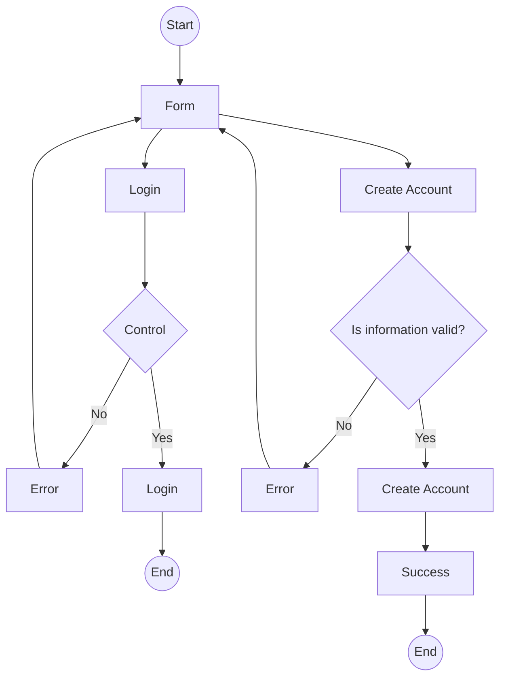
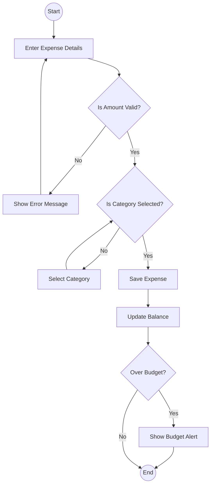
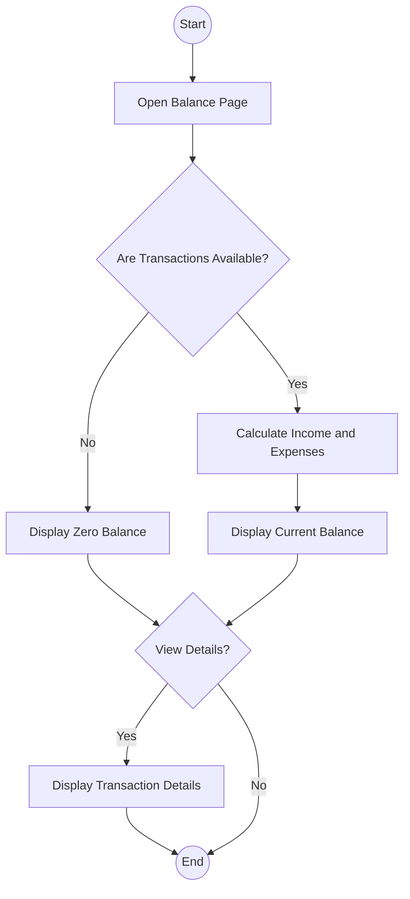
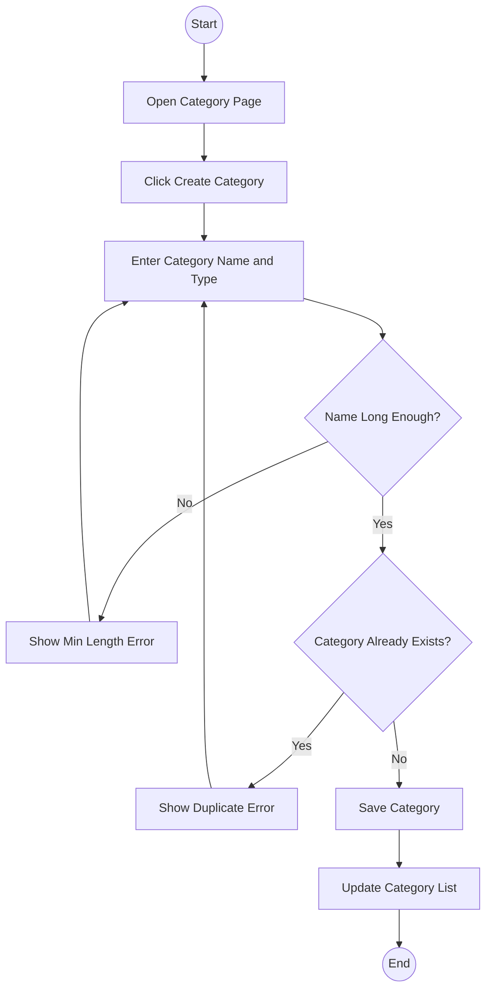
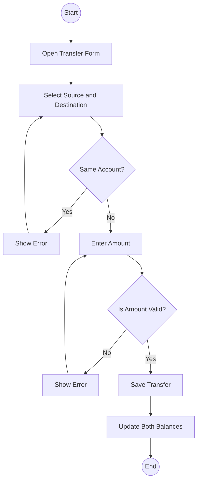
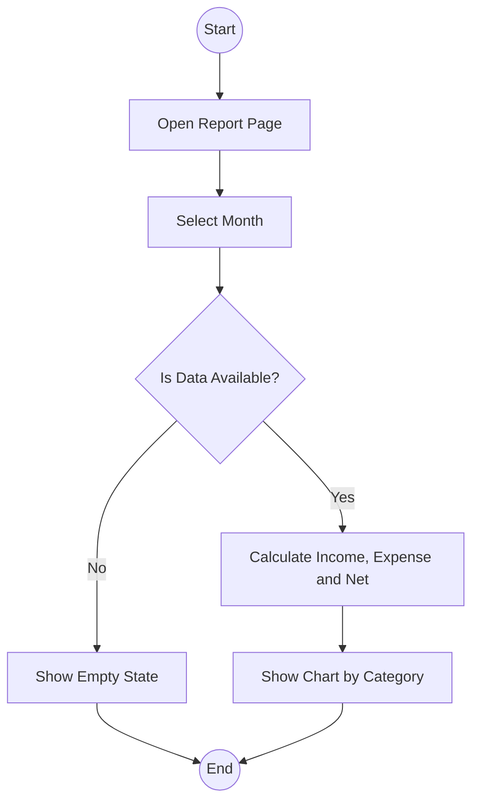

# Activity Diagrams سیستم مدیریت مالی شخصی

## ۱. Login / Sign up

## ۲. Add Expense (اضافه کردن هزینه)

## ۳. View Balance (مشاهده موجودی)

## ۴. Create Category (ساخت دسته)

## ۵. Transfer Between Accounts (انتقال بین حساب‌ها)

## ۶. Monthly Report (گزارش ماهانه)

