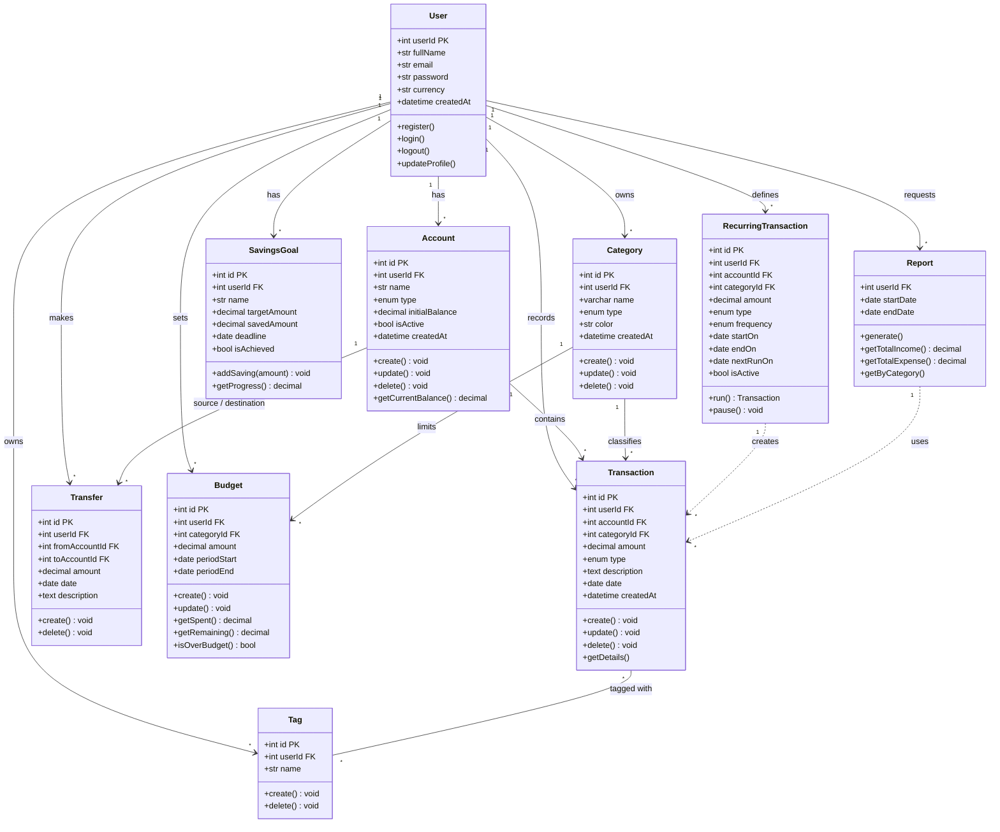

# Class Diagram سیستم مدیریت مالی شخصی

## توضیح کلاس‌ها

| کلاس | مسئولیت |
|---|---|
| User | ثبت‌نام، ورود، خروج و ویرایش پروفایل |
| Account | نگهداری حساب‌ها و محاسبه موجودی فعلی |
| Category | دسته‌بندی درآمد و هزینه |
| Transaction | ثبت، ویرایش، حذف و نمایش جزئیات تراکنش |
| Transfer | جابه‌جایی پول بین دو حساب |
| Tag | برچسب‌گذاری تراکنش‌ها |
| Budget | تعیین سقف هزینه برای هر دسته و بررسی عبور از آن |
| RecurringTransaction | ساخت خودکار تراکنش‌های تکراری |
| SavingsGoal | پیگیری هدف پس‌انداز |
| Report | ساخت گزارش در یک بازه زمانی از روی تراکنش‌ها |
