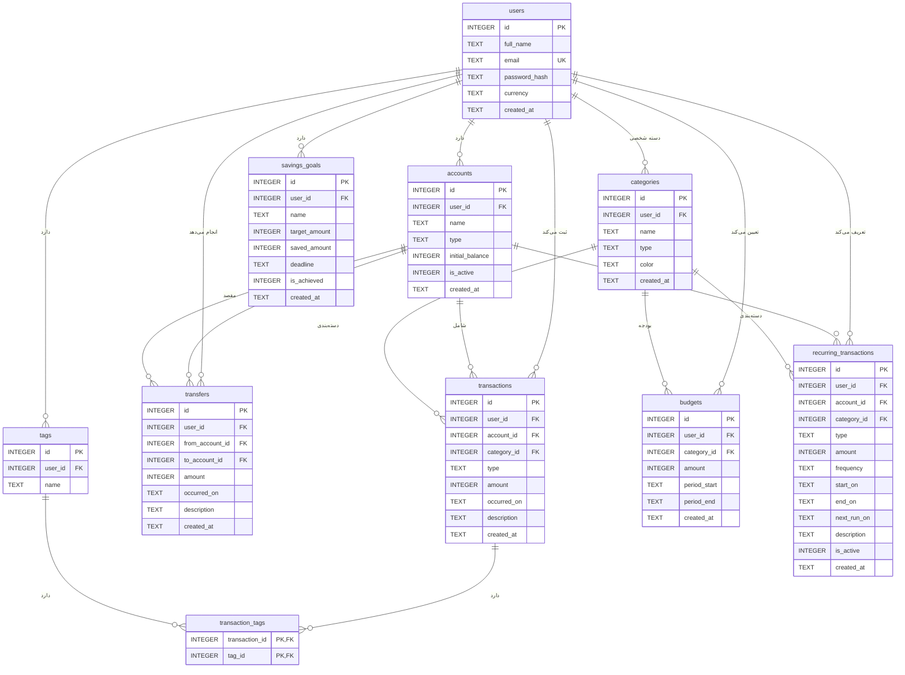

# طراحی دیتابیس سیستم مدیریت مالی شخصی

## نمودار ER

## جداول

### users (کاربران)

| ستون | نوع | قید |
|---|---|---|
| id | INTEGER | کلید اصلی |
| full_name | TEXT | الزامی |
| email | TEXT | الزامی، یکتا |
| password_hash | TEXT | الزامی |
| currency | TEXT | پیش‌فرض IRT |
| created_at | TEXT | زمان ایجاد |

### accounts (حساب‌ها)

| ستون | نوع | قید |
|---|---|---|
| id | INTEGER | کلید اصلی |
| user_id | INTEGER | کلید خارجی به users |
| name | TEXT | الزامی، یکتا برای هر کاربر |
| type | TEXT | cash، bank، card یا wallet |
| initial_balance | INTEGER | موجودی اولیه |
| is_active | INTEGER | ۰ یا ۱ |
| created_at | TEXT | زمان ایجاد |

### categories (دسته‌ها)

| ستون | نوع | قید |
|---|---|---|
| id | INTEGER | کلید اصلی |
| user_id | INTEGER | کلید خارجی به users؛ خالی یعنی دسته پیش‌فرض |
| name | TEXT | الزامی |
| type | TEXT | income یا expense |
| color | TEXT | رنگ نمایش |
| created_at | TEXT | زمان ایجاد |

### transactions (تراکنش‌ها)

| ستون | نوع | قید |
|---|---|---|
| id | INTEGER | کلید اصلی |
| user_id | INTEGER | کلید خارجی به users |
| account_id | INTEGER | کلید خارجی به accounts |
| category_id | INTEGER | کلید خارجی به categories |
| type | TEXT | income یا expense |
| amount | INTEGER | بزرگ‌تر از صفر (تومان) |
| occurred_on | TEXT | تاریخ تراکنش |
| description | TEXT | توضیح |
| created_at | TEXT | زمان ایجاد |

### transfers (انتقال بین حساب‌ها)

| ستون | نوع | قید |
|---|---|---|
| id | INTEGER | کلید اصلی |
| user_id | INTEGER | کلید خارجی به users |
| from_account_id | INTEGER | کلید خارجی به accounts (مبدأ) |
| to_account_id | INTEGER | کلید خارجی به accounts (مقصد)، مخالف مبدأ |
| amount | INTEGER | بزرگ‌تر از صفر |
| occurred_on | TEXT | تاریخ انتقال |
| description | TEXT | توضیح |
| created_at | TEXT | زمان ایجاد |

### tags (برچسب‌ها)

| ستون | نوع | قید |
|---|---|---|
| id | INTEGER | کلید اصلی |
| user_id | INTEGER | کلید خارجی به users |
| name | TEXT | یکتا برای هر کاربر |

### transaction_tags (ارتباط تراکنش و برچسب)

| ستون | نوع | قید |
|---|---|---|
| transaction_id | INTEGER | کلید خارجی به transactions، بخشی از کلید اصلی |
| tag_id | INTEGER | کلید خارجی به tags، بخشی از کلید اصلی |

### budgets (بودجه‌ها)

| ستون | نوع | قید |
|---|---|---|
| id | INTEGER | کلید اصلی |
| user_id | INTEGER | کلید خارجی به users |
| category_id | INTEGER | کلید خارجی به categories |
| amount | INTEGER | سقف بودجه، بزرگ‌تر از صفر |
| period_start | TEXT | شروع دوره |
| period_end | TEXT | پایان دوره، بعد از شروع |
| created_at | TEXT | زمان ایجاد |

### recurring_transactions (تراکنش‌های تکراری)

| ستون | نوع | قید |
|---|---|---|
| id | INTEGER | کلید اصلی |
| user_id | INTEGER | کلید خارجی به users |
| account_id | INTEGER | کلید خارجی به accounts |
| category_id | INTEGER | کلید خارجی به categories |
| type | TEXT | income یا expense |
| amount | INTEGER | بزرگ‌تر از صفر |
| frequency | TEXT | daily، weekly، monthly یا yearly |
| start_on | TEXT | تاریخ شروع |
| end_on | TEXT | تاریخ پایان (اختیاری) |
| next_run_on | TEXT | تاریخ اجرای بعدی |
| description | TEXT | توضیح |
| is_active | INTEGER | ۰ یا ۱ |
| created_at | TEXT | زمان ایجاد |

### savings_goals (اهداف پس‌انداز)

| ستون | نوع | قید |
|---|---|---|
| id | INTEGER | کلید اصلی |
| user_id | INTEGER | کلید خارجی به users |
| name | TEXT | الزامی |
| target_amount | INTEGER | مبلغ هدف، بزرگ‌تر از صفر |
| saved_amount | INTEGER | مبلغ پس‌انداز شده |
| deadline | TEXT | مهلت (اختیاری) |
| is_achieved | INTEGER | ۰ یا ۱ |
| created_at | TEXT | زمان ایجاد |

## روابط

| جدول اول | جدول دوم | نوع رابطه | توضیح |
|---|---|---|---|
| users | accounts | یک به چند | هر کاربر چند حساب دارد |
| users | categories | یک به چند | هر کاربر می‌تواند دسته شخصی بسازد |
| users | transactions | یک به چند | هر کاربر چند تراکنش دارد |
| users | transfers | یک به چند | هر کاربر چند انتقال دارد |
| users | tags | یک به چند | هر کاربر برچسب‌های خودش را دارد |
| users | budgets | یک به چند | هر کاربر چند بودجه دارد |
| users | recurring_transactions | یک به چند | هر کاربر چند تراکنش تکراری دارد |
| users | savings_goals | یک به چند | هر کاربر چند هدف پس‌انداز دارد |
| accounts | transactions | یک به چند | هر تراکنش در یک حساب ثبت می‌شود |
| accounts | transfers | یک به چند (دو بار) | هر انتقال یک حساب مبدأ و یک حساب مقصد دارد |
| accounts | recurring_transactions | یک به چند | هر تراکنش تکراری به یک حساب وصل است |
| categories | transactions | یک به چند | هر تراکنش یک دسته دارد |
| categories | budgets | یک به چند | هر بودجه برای یک دسته است |
| categories | recurring_transactions | یک به چند | هر تراکنش تکراری یک دسته دارد |
| transactions | tags | چند به چند | از طریق جدول transaction_tags |
