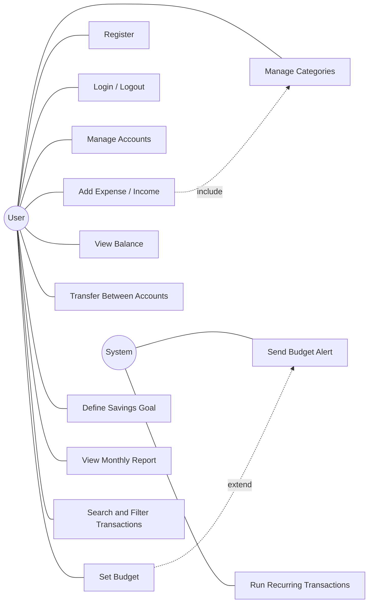
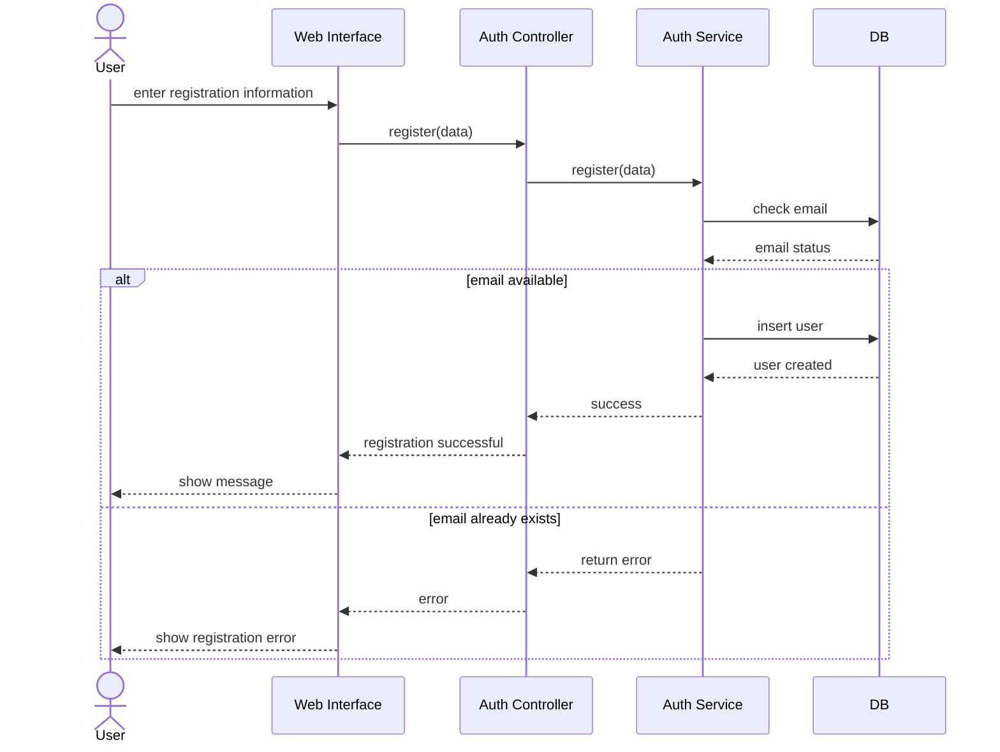

# Use Cases سیستم مدیریت مالی شخصی

## بازیگران (Actors)

| بازیگر | توضیح |
|---|---|
| User | کاربری که دخل و خرج خودش را مدیریت می‌کند |
| System | خود سیستم که کارهای زمان‌دار مثل تراکنش تکراری و هشدار بودجه را انجام می‌دهد |

## نمودار Use Case

## UC1: Register (ثبت‌نام)

**بازیگر:** User

**پیش‌شرط:** کاربر حساب کاربری ندارد

**جریان اصلی:**
1. open app → show sign up form for the first time
2. user fills out the form (name, email, password)
3. hit the submit button
4. system checks the email
5. profile created → show success message

**جریان‌های جایگزین:**
- alt 1: email already exists → show error → user enters another email
- alt 2: password is too short → show error → user enters a stronger password

**پس‌شرط:** کاربر ساخته شده و وارد سیستم می‌شود

## UC2: Login (ورود)

**بازیگر:** User

**جریان اصلی:**
1. open login form
2. user enters email and password
3. hit the login button
4. system checks the information
5. user goes to dashboard

**جریان‌های جایگزین:**
- alt 1: email or password is wrong → show error → try again

## UC4: Create Category (ساخت دسته)

**بازیگر:** User

**پیش‌شرط:** کاربر وارد شده است

**جریان اصلی:**
1. show category page
2. user clicks on create category button
3. fill out form with category name and type (income / expense)
4. hit submit → form gets closed
5. category list gets updated

**جریان‌های جایگزین:**
- alt 1: if category already exists → show duplicate error → pick another name
- alt 2: category min length error → input a category with more words

## UC5: Add Expense (ثبت هزینه)

**بازیگر:** User

**پیش‌شرط:** کاربر وارد شده و حداقل یک حساب دارد

**جریان اصلی:**
1. user clicks on add expense
2. enter expense details (amount, date, description)
3. select account and category
4. hit save → expense saved
5. account balance gets updated

**جریان‌های جایگزین:**
- alt 1: amount is not valid → show error message → enter amount again
- alt 2: category not selected → ask user to select category
- alt 3: expense is over the budget → save and show budget alert

## UC6: View Balance (مشاهده موجودی)

**بازیگر:** User

**جریان اصلی:**
1. open balance page
2. system calculates income and expenses
3. display current balance of each account
4. user clicks on view details → display transaction details

**جریان‌های جایگزین:**
- alt 1: no transaction available → display zero balance

## UC7: Transfer Between Accounts (انتقال بین حساب‌ها)

**بازیگر:** User

**جریان اصلی:**
1. user opens transfer form
2. select source account and destination account
3. enter amount
4. hit submit → transfer saved
5. balance of both accounts gets updated

**جریان‌های جایگزین:**
- alt 1: source and destination are the same → show error
- alt 2: amount is not valid → show error

## UC8: Set Budget (تعیین بودجه)

**بازیگر:** User

**جریان اصلی:**
1. user opens budget page
2. select category and period
3. enter budget amount
4. hit save → budget saved
5. show spent and remaining amount

**جریان‌های جایگزین:**
- alt 1: budget already exists for this category and period → show error

## UC10: View Monthly Report (گزارش ماهانه)

**بازیگر:** User

**جریان اصلی:**
1. user opens report page
2. select month
3. system calculates total income, total expense and net
4. show chart of expenses by category

**جریان‌های جایگزین:**
- alt 1: no data for this month → show empty state

## UC12: Run Recurring Transactions (اجرای تراکنش تکراری)

**بازیگر:** System

**جریان اصلی:**
1. system checks recurring transactions every day
2. find items where next run date is today
3. create transaction
4. update next run date
5. send reminder to user

## Sequence Diagram: User Registration

